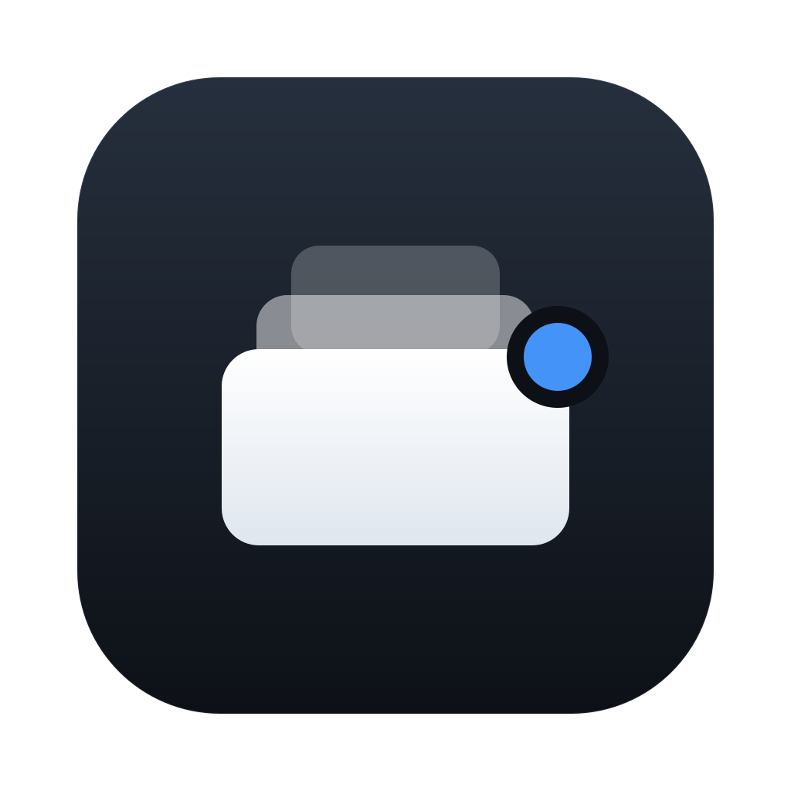
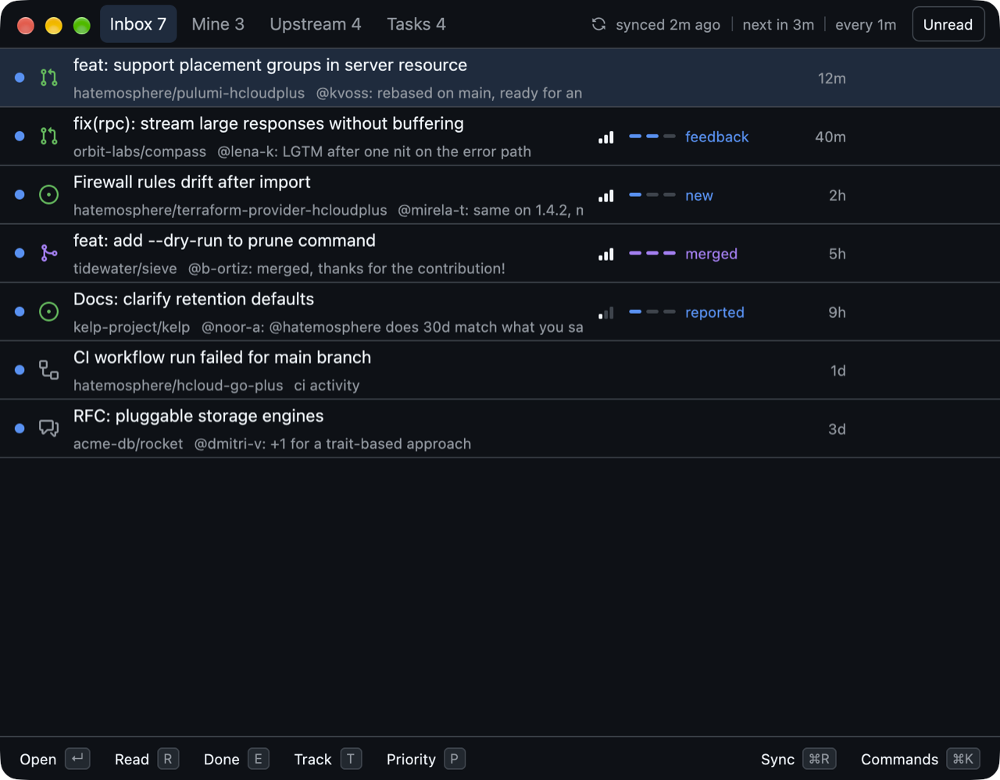
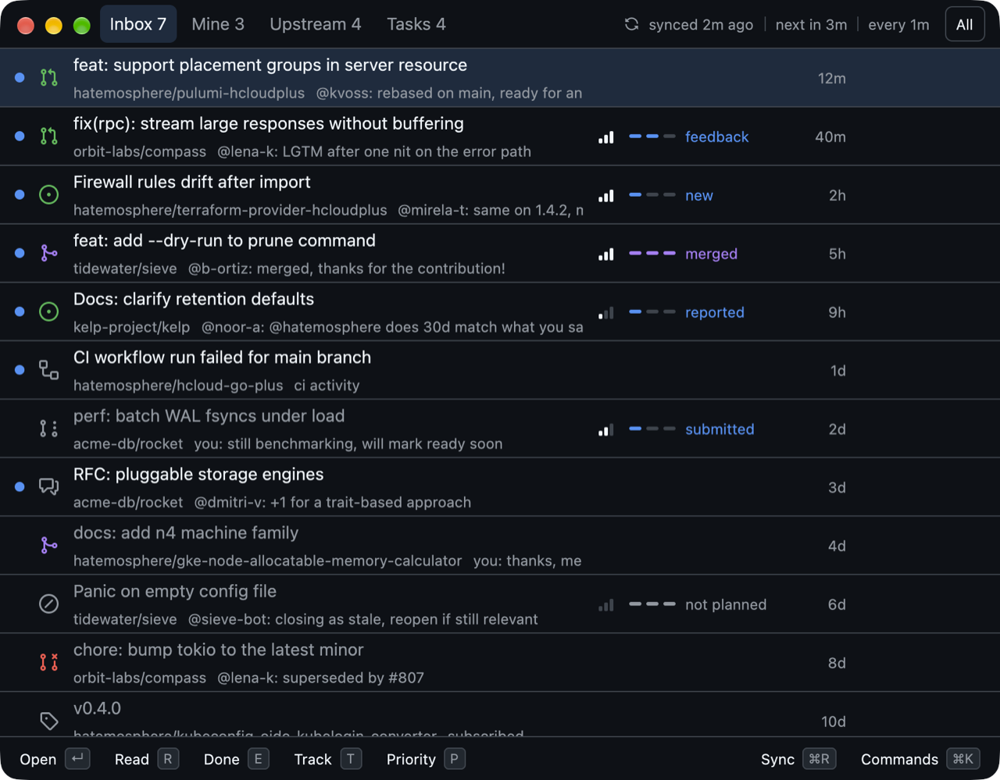
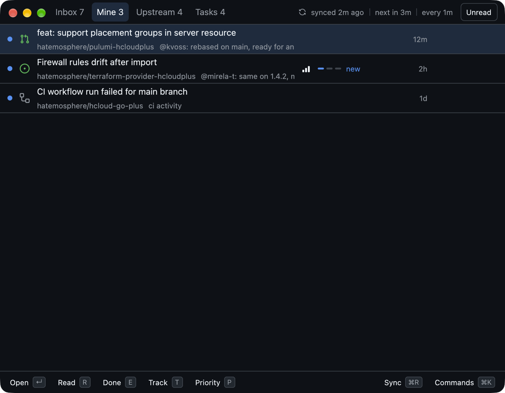
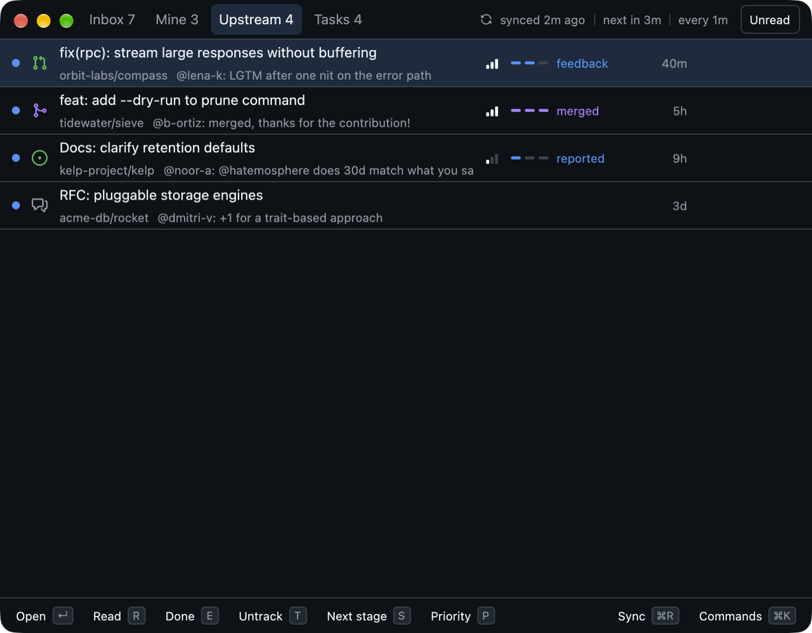
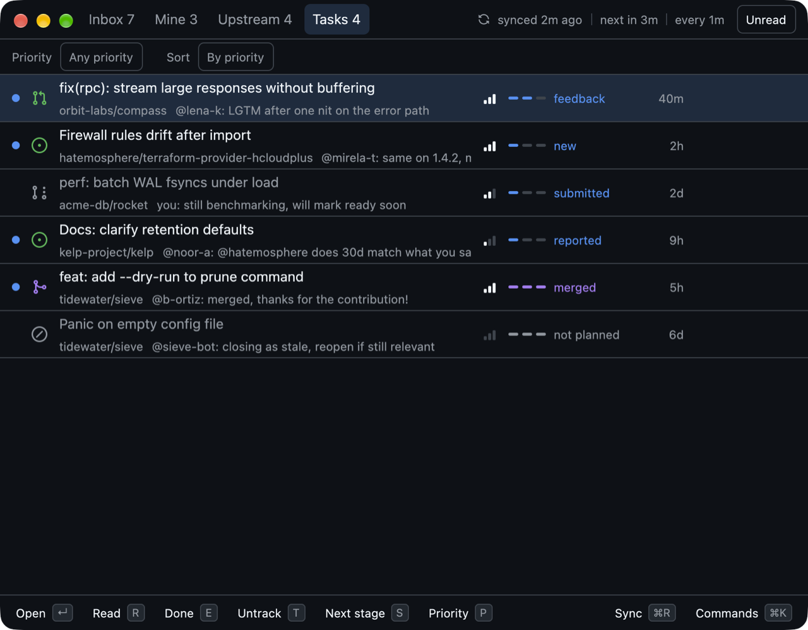
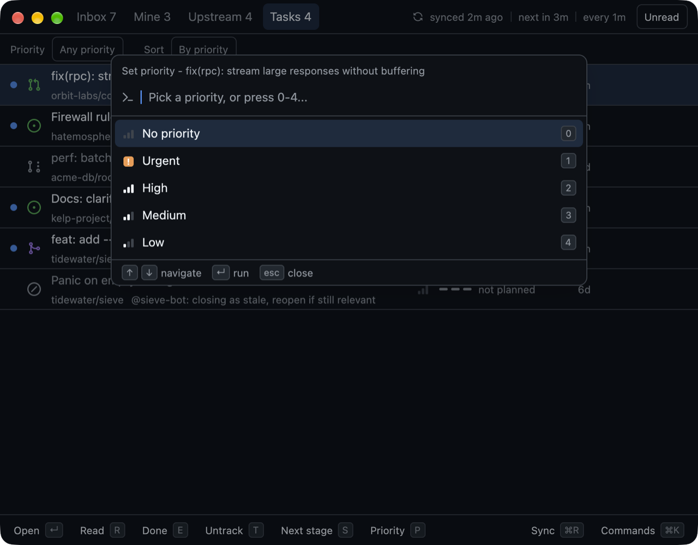
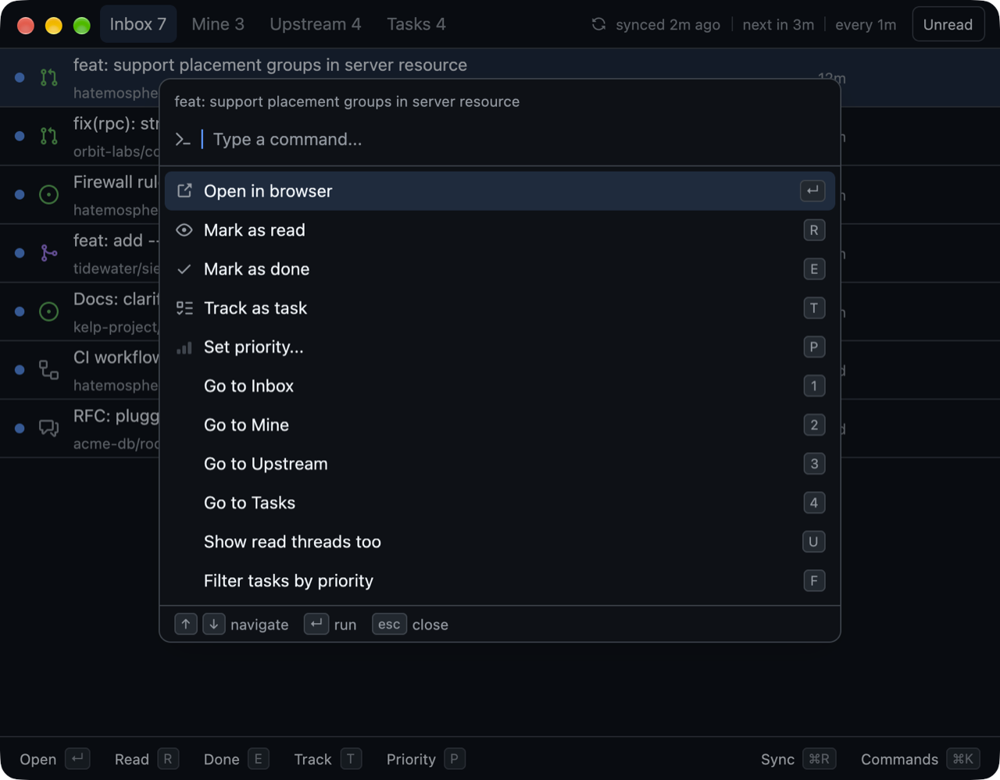
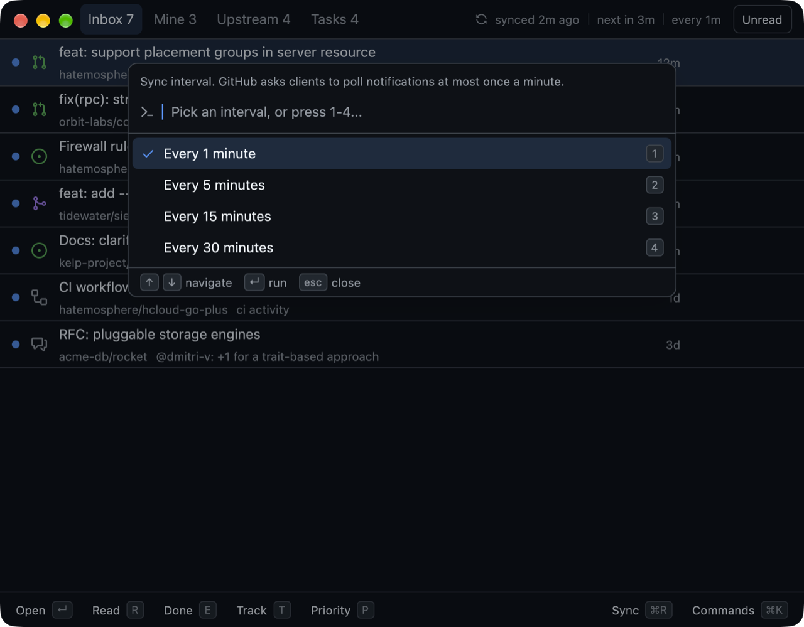

<p align="center">
  
</p>

<h1 align="center">ossdeck</h1>

<p align="center">
  Native macOS command centre for your open source GitHub activity.<br>
  Rust + <a href="https://gpui.rs">GPUI</a> (Zed's GPU UI framework), SQLite, no Electron.
</p>

> [!WARNING]
> Vibe-coded proof of concept. Barely tested, no stability guarantees. Use at your own risk.

<p align="center">
  
</p>

## Features

<table>
  <tr>
    <td width="45%">
      <h3>One inbox, only open source</h3>
      Notifications from your public repos plus upstream threads you take part in: authored, commented, mentioned, review requested. Private and watch-only repos stay out.<br><br>
      GitHub-style status icons and the latest comment on every row. Toggle <kbd>U</kbd> to include read threads.
    </td>
    <td></td>
  </tr>
  <tr>
    <td>
      <h3>Mine vs Upstream</h3>
      Your repos on one tab, PRs and issues you sent elsewhere on another. Switch with <kbd>1</kbd>-<kbd>4</kbd>.
    </td>
    <td>
      <br>
      
    </td>
  </tr>
  <tr>
    <td>
      <h3>Mini task tracker</h3>
      Track any thread with <kbd>T</kbd>. Stages fit the thread and the last one follows GitHub's state:
      <ul>
        <li>PR in your repo: new &rarr; reviewed &rarr; merged</li>
        <li>PR you sent upstream: submitted &rarr; feedback &rarr; merged</li>
        <li>Issue in your repo: new &rarr; triaged &rarr; closed</li>
        <li>Issue you opened upstream: reported &rarr; answered &rarr; resolved</li>
      </ul>
      Opening a thread in your repo or a reply upstream moves it along; <kbd>S</kbd> steps it by hand.
    </td>
    <td></td>
  </tr>
  <tr>
    <td>
      <h3>Linear-style priorities</h3>
      <kbd>P</kbd> then <kbd>0</kbd>-<kbd>4</kbd>: none, urgent, high, medium, low. The Tasks tab sorts by priority and filters with <kbd>F</kbd>.
    </td>
    <td></td>
  </tr>
  <tr>
    <td>
      <h3>Keyboard first, buttons too</h3>
      Every action has a hotkey, a button and a command palette entry (<kbd>&#8984;</kbd><kbd>K</kbd>). Buttons and tooltips show their shortcut.
    </td>
    <td></td>
  </tr>
  <tr>
    <td>
      <h3>Sync that respects GitHub</h3>
      Background sync every 1-30 minutes (GitHub's 60s poll interval is the floor), free conditional requests, parallel paging, octocrab-style retries. Read and done sync back to your GitHub inbox.
    </td>
    <td></td>
  </tr>
  <tr>
    <td>
      <h3>Lives in the menu bar</h3>
      Unread count with a blue dot, latest threads one click away, Dock badge, native notifications, launch at login. Closing the window keeps it syncing.
    </td>
    <td align="center">
      
      &nbsp;
      
    </td>
  </tr>
</table>

## Shortcuts

| Key | Action | Key | Action |
|---|---|---|---|
| <kbd>J</kbd> / <kbd>K</kbd> | Move | <kbd>T</kbd> | Track / untrack task |
| <kbd>&#8629;</kbd> / <kbd>O</kbd> | Open in browser | <kbd>S</kbd> | Next task stage |
| <kbd>R</kbd> | Mark read | <kbd>P</kbd> | Set priority |
| <kbd>E</kbd> | Mark done | <kbd>F</kbd> / <kbd>&#8679;</kbd><kbd>S</kbd> | Filter / sort tasks |
| <kbd>U</kbd> | Unread only / all | <kbd>I</kbd> | Sync interval |
| <kbd>1</kbd>-<kbd>4</kbd> | Tabs | <kbd>&#8984;</kbd><kbd>R</kbd> | Sync now |
| <kbd>&#8984;</kbd><kbd>K</kbd> | Command palette | <kbd>&#8984;</kbd><kbd>W</kbd> | Close window |

## Requirements

- macOS 13+, Rust (2024 edition), Xcode with the Metal toolchain (`xcodebuild -downloadComponent MetalToolchain`)
- [`gh`](https://cli.github.com) logged in (`gh auth login`), or `GITHUB_TOKEN` set

## Build

```sh
./bundle.sh   # builds release, creates ossdeck.app, installs it to ~/Applications
```

`cargo run` works for development, but notifications and launch at login need the bundled app.

Data lives in `~/Library/Application Support/ossdeck/ossdeck.db`.

Screenshots use made-up data: `scripts/screenshots.sh` regenerates them from `scripts/demo.sql` without touching your real data.

Icons: [Octicons](https://github.com/primer/octicons) (MIT).
